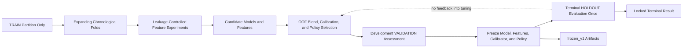
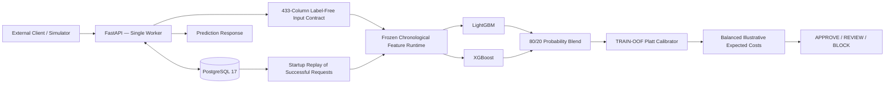
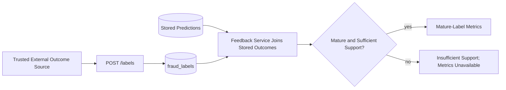
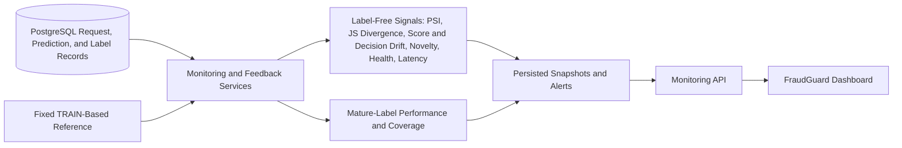
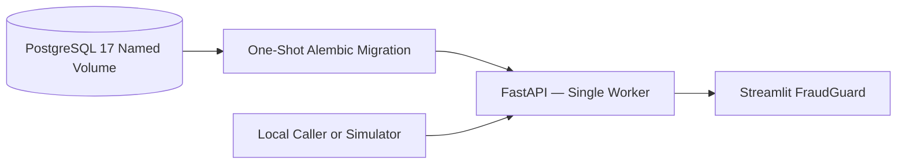

# System architecture

This repository is a local, production-style portfolio demonstration. It does not represent a deployed financial institution system. The final model and policy artifacts are frozen; these diagrams describe their existing behavior.

## Offline development and evaluation

The dataset is split in time order: 413,378 TRAIN, 88,581 VALIDATION, and 88,581 later HOLDOUT rows. Preprocessing and target-derived historical features are fit or replayed using only information available earlier in time. The terminal HOLDOUT result was not used to revise the frozen system.

## Online scoring and audit

For each accepted prediction operation, the API stores a durable request sequence and boundary, canonical label-free raw payload, prediction, and audit records. A successful batch writes its rows atomically. An identical idempotency-key retry returns the stored response and does not update runtime history. A changed payload with that key returns 409. Reusing an already-scored TransactionID with a new key returns 409.

At process startup, the API verifies the frozen bundle and schema, then replays successful requests in sequence order using their original batch boundaries. Replay reads requests and transaction payloads, does not write new predictions, and does not read fraud labels.

## Delayed labels and feedback

Labels can represent a later chargeback, trusted fraud report, or analyst resolution. The source supplies observation and maturity timestamps. Immature labels can be stored but do not enter performance calculations until mature. Label ingestion never updates frozen features, calibration, or policy.

## Monitoring

A drift signal is evidence of a changed distribution, not proof of model failure. Performance degradation requires mature labels and sufficient support. No alert triggers automatic retraining.

## Local deployment

Compose health checks gate startup: the database becomes healthy before migration, migration must finish successfully before API startup, and dashboard waits for API health. The API is intentionally single-worker because mutable chronological feature history is process-local. PostgreSQL enables recovery after restart; it does not coordinate live histories across replicas.

