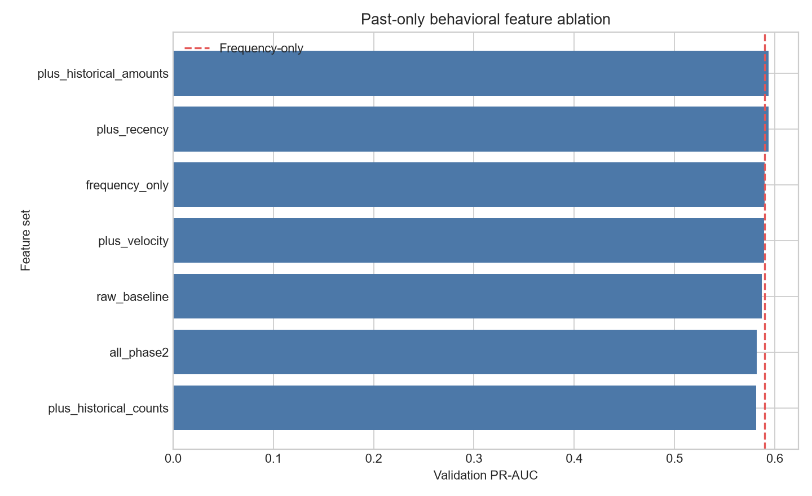

# Past-Only Behavioral Features

## Implemented features

- **historical_counts:** card1_previous_tx_count, addr1_previous_tx_count, device_previous_tx_count, email_previous_tx_count, card1_addr1_previous_tx_count
- **historical_amounts:** card1_previous_avg_amount, card1_previous_max_amount, amount_vs_card1_previous_avg, addr1_previous_avg_amount, amount_vs_addr1_previous_avg
- **recency:** seconds_since_card1_previous_transaction, seconds_since_device_previous_transaction
- **velocity:** card1_tx_count_last_1h, card1_tx_count_last_24h

## Past-only methodology and leakage safeguards

Rows are ordered by `TransactionDT`, then `TransactionID`. Counts, amount aggregates, and
recency are calculated before the current row updates history. Velocity requires
`T - window < previous_time < T`, excluding current and equal-time transactions. Missing
entities use an explicit bucket. TRAIN alone initializes state; VALIDATION is processed
sequentially without labels. No target statistic is used. The reserved final split is untouched.

## Observed validation results

| Version | Features | PR-AUC | ROC-AUC | Precision | Recall | F1 | Seconds |
| --- | ---: | ---: | ---: | ---: | ---: | ---: | ---: |
| plus_historical_amounts | 443 | 0.593938 | 0.919463 | 0.573609 | 0.555884 | 0.564608 | 40.3 |
| plus_recency | 440 | 0.593936 | 0.924308 | 0.534618 | 0.583826 | 0.558140 | 64.4 |
| frequency_only | 438 | 0.589631 | 0.921839 | 0.577205 | 0.544379 | 0.560311 | 36.5 |
| plus_velocity | 440 | 0.589453 | 0.922244 | 0.556248 | 0.557528 | 0.556887 | 39.0 |
| raw_baseline | 432 | 0.587317 | 0.921482 | 0.572638 | 0.533859 | 0.552569 | 34.2 |
| all_phase2 | 452 | 0.581880 | 0.921848 | 0.526961 | 0.565417 | 0.545512 | 42.0 |
| plus_historical_counts | 443 | 0.581491 | 0.918272 | 0.546960 | 0.564760 | 0.555717 | 32.8 |

- Previous best frequency-only PR-AUC: **0.589631**
- Best behavioral feature set: **plus_historical_amounts**
- New best behavioral PR-AUC: **0.593938**
- Absolute PR-AUC improvement: **+0.004307**
- Relative PR-AUC improvement: **+0.73%**
- Winning behavioral model features: **443**

## Runtime and memory observations

- Feature generation: **7.8 seconds**
- Behavioral feature matrices: **26.8 MiB**
- Notebook experiment time before report write: **330.1 seconds**
- Window counts use grouped NumPy binary searches rather than full-data row loops.

## Interpretation of observed results

- Helped versus frequency-only: **plus_historical_amounts, plus_recency**.
- Hurt or added little value: **plus_velocity, all_phase2, plus_historical_counts**.
Feature groups are retained only when their validation PR-AUC exceeds the frequency-only
reference. Threshold metrics remain fixed at 0.50 and were not optimized.

## Hypotheses for later work (not implemented)

Entity-specific window choices or carefully selected additional entities may improve signal,
but require separate leakage-safe validation. Graph features, rules, SHAP, and threshold
optimization remain outside this phase.
