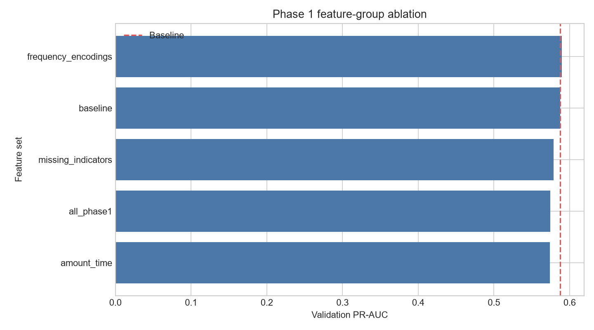

# Feature Engineering Phase 1

## Experimental design

All experiments fit on the chronological training split and score the fixed validation split.
The holdout set is not assigned or evaluated. LightGBM parameters are fixed at
`learning_rate=0.1`, `n_estimators=400`, and `num_leaves=63`.

Frequency maps, numeric preprocessing statistics, and the relative-time origin are learned from
training only. Unseen validation categories receive frequency zero. No target-derived feature is
used.

## Observed results

| Version | Features | PR-AUC | ROC-AUC | Precision | Recall | F1 |
| --- | ---: | ---: | ---: | ---: | ---: | ---: |
| frequency_encodings | 438 | 0.589631 | 0.921839 | 0.577205 | 0.544379 | 0.560311 |
| baseline | 432 | 0.587317 | 0.921482 | 0.572638 | 0.533859 | 0.552569 |
| missing_indicators | 437 | 0.578732 | 0.916614 | 0.559520 | 0.536160 | 0.547591 |
| all_phase1 | 446 | 0.574197 | 0.921037 | 0.513078 | 0.554569 | 0.533017 |
| amount_time | 435 | 0.573694 | 0.918147 | 0.503237 | 0.562130 | 0.531056 |

- Baseline features: **432**
- All Phase 1 features: **446**
- Absolute PR-AUC degradation: **-0.013120**
- Relative PR-AUC degradation: **-2.23%**
- Best observed feature set: **frequency_encodings** (0.589631 PR-AUC)

## Interpretation

These are validation associations under fixed model parameters. A group is helpful only if its
PR-AUC exceeds the reproduced baseline. Features that do not improve ranking are not claimed as
wins.

## Limitations

- The existing baseline preprocessor already frequency-encodes object columns, so explicit frequency
  features for object-valued candidates can be redundant; numeric entity IDs gain the clearest new
  view.
- No hyperparameter retuning, calibration, threshold optimization, or holdout evaluation is
  performed.
- Relative hour is based on an origin-unknown counter, not a known calendar timezone.

## Next proposed phase (not implemented)

Evaluate leakage-safe, past-only behavioral velocity and entity-history aggregates before graph
features.
