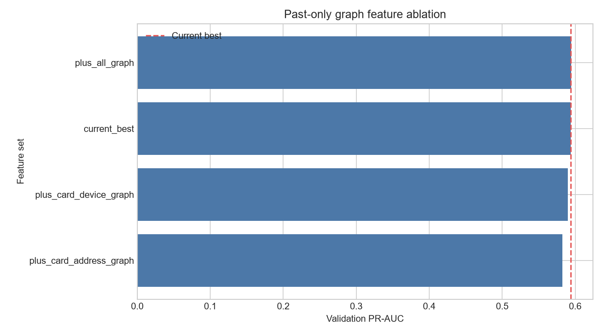

# Graph-Based Feature Engineering

## Entities, relationships, and features

Entities are `card1`, `DeviceInfo`, and `addr1`. Sparse state represents
`card1 <-> DeviceInfo` and `card1 <-> addr1`; no general graph framework is used.

- **card_device:** card_previous_unique_devices, device_previous_unique_cards, card_device_previous_pair_count, card_device_seen_before
- **card_address:** card_previous_unique_addresses, address_previous_unique_cards, card_address_previous_pair_count, card_address_seen_before

Missing endpoints are unavailable and create neither nodes nor edges.

## Strict past-only methodology

Transactions are grouped by `TransactionDT`. Every row in one timestamp batch is scored from
state created by strictly earlier timestamps. Only after all rows are scored is the batch
committed. TRAIN initializes sparse state; VALIDATION starts strictly later and advances
sequentially without labels. No target-derived graph statistic is used.

## Observed validation results

| Version | Graph features | Total | PR-AUC | ROC-AUC | Precision | Recall | F1 |
| --- | ---: | ---: | ---: | ---: | ---: | ---: | ---: |
| plus_all_graph | 8 | 451 | 0.594611 | 0.923863 | 0.548678 | 0.559500 | 0.554036 |
| current_best | 0 | 443 | 0.593938 | 0.919463 | 0.573609 | 0.555884 | 0.564608 |
| plus_card_device_graph | 4 | 447 | 0.589868 | 0.923236 | 0.550701 | 0.555227 | 0.552955 |
| plus_card_address_graph | 4 | 447 | 0.582545 | 0.922056 | 0.526075 | 0.567061 | 0.545800 |

- Previous best PR-AUC: **0.593938**
- Best graph configuration: **plus_all_graph**
- Best graph PR-AUC: **0.594611**
- Absolute PR-AUC improvement: **+0.000673**
- Relative PR-AUC improvement: **+0.11%**
- Helpful graph sets: **plus_all_graph**
- Hurt or added little value: **plus_card_device_graph, plus_card_address_graph**

## Runtime and memory observations

- Graph feature generation: **60.8 seconds**
- Graph feature matrices: **15.3 MiB**
- Traced graph-generation peak: **75.0 MiB**
- Experiment time before report write: **227.2 seconds**
- Sparse dictionaries, sets, and counters are used; no dense adjacency matrix is built.
- An initial redundant per-ablation scaling path requested a 1.36 GiB temporary array;
  reusing the identical train-fitted base and graph matrices removed that allocation.
- Final relationship state: `{'card_device_edges': 23939, 'card_address_edges': 35243, 'cards_with_devices': 7464, 'devices_with_cards': 1681, 'cards_with_addresses': 11546, 'addresses_with_cards': 330}`

## MLflow runs

Experiment: `fraud-detection-graph-features`

- **plus_all_graph:** `4379078e17c941a5886004ef1c41ff96`
- **current_best:** `b025b256263c4b208fa17b7c8448aa85`
- **plus_card_device_graph:** `e095e305af95453081da0e7866932088`
- **plus_card_address_graph:** `ea6ab08cf4dc4cd5a70228a652543dcb`

## Limitations and later hypotheses

These features capture only direct historical bipartite relationships, not multi-hop structure
or time-decayed connectivity. Any richer graph hypothesis requires a separate leakage-safe
experiment. No GNN, rules, SHAP, threshold work, or tuning is implemented here.
