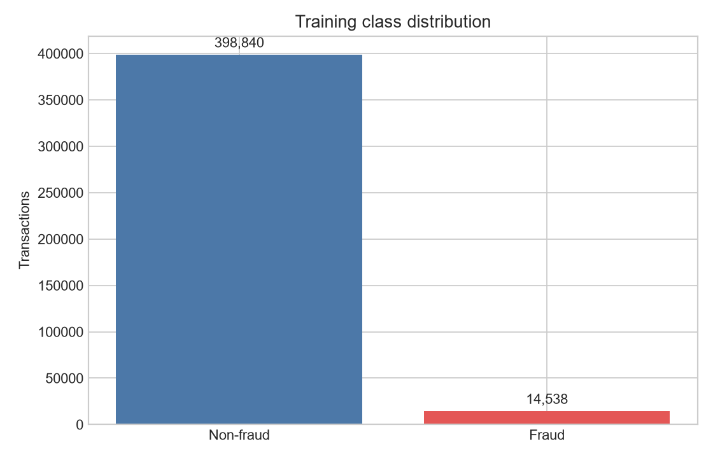
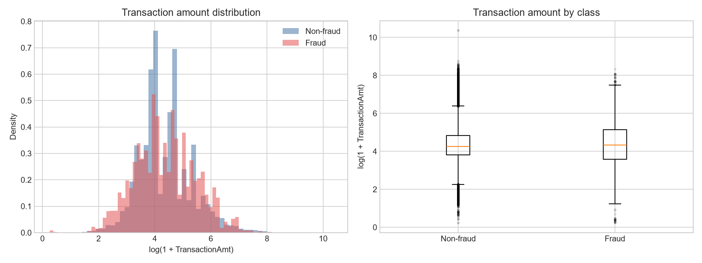
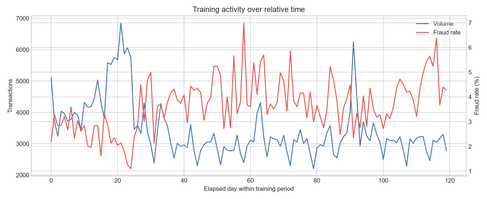
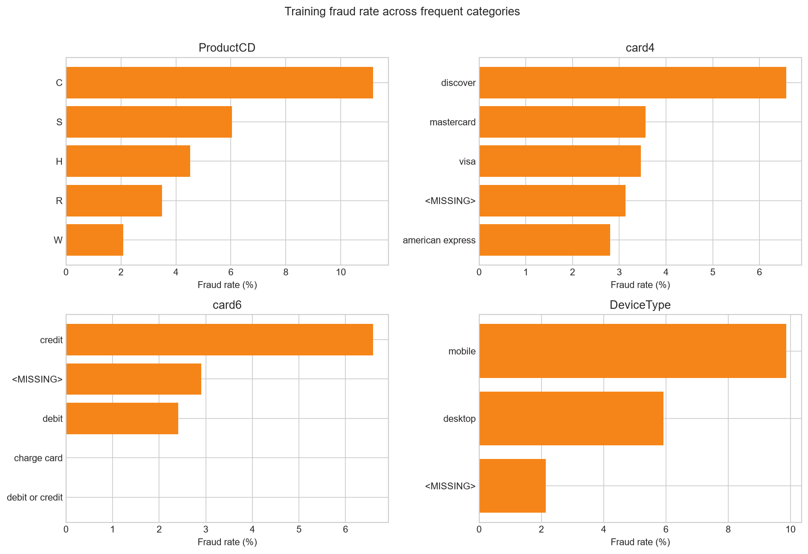
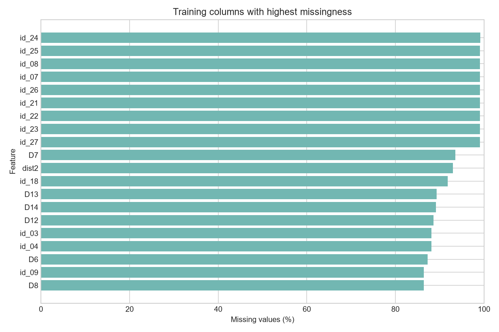

# IEEE-CIS Training-Split EDA Summary

## Scope and leakage guardrail

**Observed fact:** This report uses only the oldest chronological training partition: 
413,378 rows. The validation (88,581 rows) and holdout 
(88,581 rows) partitions were excluded from every EDA calculation and plot.

`TransactionDT` is treated only as relative time. No calendar-date interpretation was made. No
values were imputed, encoded, removed, or transformed in the persisted data.

## Target distribution

**Observed facts**

- Fraud: 14,538 transactions.
- Non-fraud: 398,840 transactions.
- Training fraud rate: **3.52%**.
- The target is strongly imbalanced.

## Transaction amount

**Observed facts**

| Class | Count | Mean | Median | Std | Q95 | Q99 | Max | IQR outliers |
| --- | --- | --- | --- | --- | --- | --- | --- | --- |
| Non-fraud | 398,840 | 134.20 | 68.95 | 238.76 | 437.00 | 1104.00 | 31937.39 | 44,908 (11.26%) |
| Fraud | 14,538 | 145.64 | 75.00 | 216.15 | 490.00 | 994.00 | 4191.00 | 1,237 (8.51%) |

The distribution is right-skewed, so the figure uses `log(1 + TransactionAmt)` for readability.
IQR outliers are reported, not removed. Fraud median amount is 
75.00, compared with 68.95 for non-fraud.

**Feature hypothesis:** A log amount representation and past-only entity-relative amount features
may be useful later. This has not been tested as model signal.

## Relative-time behavior

**Observed facts**

- The training period spans elapsed days 0 through
  119.
- Fraud rate in the first chronological 20% is **2.69%**; in the last 20% it is
  **4.06%**.
- Daily transaction volume and fraud rate vary through the training period; this supports retaining
  chronological validation rather than random splitting.

**Feature hypothesis:** Past-only velocity and relative-hour/day patterns deserve later testing.
No temporal feature is created here.

## Interpretable categorical features

**Observed facts**

| Feature | Unique | Missing | Highest supported fraud-rate category |
| --- | --- | --- | --- |
| ProductCD | 5 | 0.00% | C - 11.17% (50,006 rows) |
| card4 | 4 | 0.20% | discover - 6.57% (4,763 rows) |
| card6 | 4 | 0.20% | credit - 6.59% (109,361 rows) |
| P_emaildomain | 59 | 15.55% | outlook.com - 8.90% (3,550 rows) |
| R_emaildomain | 60 | 75.07% | outlook.com - 14.59% (1,775 rows) |
| DeviceType | 2 | 74.02% | mobile - 9.86% (41,434 rows) |
| DeviceInfo | 1,546 | 77.90% | <OTHER> - 13.27% (18,887 rows) |

Only frequent categories are shown; remaining values are grouped into `<OTHER>` for reporting.
Category-level target differences are associations, not causal evidence.

## Card and identity overview

**Observed facts**

| Feature | Unique | Band | Missing | Most common | Top frequency |
| --- | --- | --- | --- | --- | --- |
| card1 | 12,242 | high | 0.00% | 7919 | 2.45% |
| DeviceInfo | 1,546 | high | 77.90% | nan | 77.90% |
| card2 | 500 | high | 1.58% | 321.0 | 8.14% |
| addr1 | 318 | high | 11.50% | nan | 11.50% |
| id_33 | 183 | high | 86.09% | nan | 86.09% |
| card5 | 110 | high | 0.72% | 226.0 | 50.20% |
| id_31 | 108 | high | 74.06% | nan | 74.06% |
| card3 | 105 | high | 0.20% | 150.0 | 87.85% |
| id_30 | 71 | medium | 85.05% | nan | 85.05% |
| addr2 | 67 | medium | 11.50% | 87.0 | 87.63% |
| R_emaildomain | 60 | medium | 75.07% | nan | 75.07% |
| P_emaildomain | 59 | medium | 15.55% | gmail.com | 38.52% |
| ProductCD | 5 | low | 0.00% | W | 72.07% |
| card4 | 4 | low | 0.20% | visa | 65.33% |
| card6 | 4 | low | 0.20% | debit | 73.33% |
| id_34 | 4 | low | 85.04% | nan | 85.04% |
| M4 | 3 | low | 48.42% | nan | 48.42% |
| id_23 | 3 | low | 99.05% | nan | 99.05% |
| id_15 | 3 | low | 73.98% | nan | 73.98% |
| M5 | 2 | low | 60.42% | nan | 60.42% |

There are 8 high-cardinality object/card/address/device features in this
reviewed set. These identifiers may support behavior aggregation or graph connectivity later, but
raw target encoding would require strict out-of-fold and time-aware controls.

## Missingness

**Observed facts**

- Columns with no missing values: 63.
- Low missingness (0-20%): 119.
- Moderate missingness (>20-60%): 39.
- High missingness (>60%): 213.

| Feature | Missing rows | Missing rate |
| --- | --- | --- |
| id_24 | 409,769 | 99.13% |
| id_25 | 409,463 | 99.05% |
| id_07 | 409,448 | 99.05% |
| id_08 | 409,448 | 99.05% |
| id_26 | 409,445 | 99.05% |
| id_21 | 409,443 | 99.05% |
| id_27 | 409,439 | 99.05% |
| id_23 | 409,439 | 99.05% |
| id_22 | 409,439 | 99.05% |
| D7 | 386,632 | 93.53% |
| dist2 | 384,224 | 92.95% |
| id_18 | 379,355 | 91.77% |
| D13 | 369,305 | 89.34% |
| D14 | 368,410 | 89.12% |
| D12 | 366,089 | 88.56% |

Selected missing-versus-present target comparisons:

| Feature | Status | Rows | Fraud rate |
| --- | --- | --- | --- |
| id_24 | missing | 409,769 | 3.48% |
| id_24 | present | 3,609 | 8.06% |
| id_25 | missing | 409,463 | 3.48% |
| id_25 | present | 3,915 | 7.84% |
| id_07 | missing | 409,448 | 3.48% |
| id_07 | present | 3,930 | 7.81% |
| id_08 | missing | 409,448 | 3.48% |
| id_08 | present | 3,930 | 7.81% |
| id_26 | missing | 409,445 | 3.48% |
| id_26 | present | 3,933 | 7.78% |
| P_emaildomain | missing | 64,296 | 3.00% |
| P_emaildomain | present | 349,082 | 3.61% |
| R_emaildomain | missing | 310,337 | 2.13% |
| R_emaildomain | present | 103,041 | 7.70% |
| DeviceType | missing | 305,981 | 2.14% |
| DeviceType | present | 107,397 | 7.44% |
| DeviceInfo | missing | 322,016 | 2.59% |
| DeviceInfo | present | 91,362 | 6.79% |
| dist1 | missing | 255,775 | 4.44% |
| dist1 | present | 157,603 | 2.01% |

**Feature hypothesis:** Missing indicators may contain signal for selected fields. They must be
evaluated temporally before any imputation or column-removal policy is chosen.

## Cardinality and later encoding considerations

**Observed facts:** Cardinality bands are low (<=10), medium (11-100), and high (>100). The table
above reports the most common value and its frequency, helping distinguish concentrated categories
from identifier-like fields.

**Feature hypotheses**

1. Log-transform `TransactionAmt` while retaining the raw amount.
2. Add missing-value indicators only for fields whose missingness remains useful out of time.
3. Add past-only transaction velocity by card, address, email, and device identifiers.
4. Add past-only entity amount deviations and rolling aggregates.
5. Test frequency encoding for high-cardinality card, email, and device fields.
6. Test time-safe categorical encodings for medium-cardinality fields.
7. Test interactions among `ProductCD`, card network/type, email domain, and device type.
8. Build graph features from shared cards, addresses, emails, and devices in a later dedicated step.
9. Test relative time-of-day and day progression without treating `TransactionDT` as a real date.

## Potential leakage and suspicious-feature review

- **`TransactionID` - review required, not confirmed leakage.** It is an identifier and is likely
  correlated with collection order. It should not be treated as an ordinary magnitude feature.
- **`TransactionDT` - temporal proxy, not confirmed leakage.** It is available at transaction time,
  but can let a model memorize changing base rates. Evaluation must remain chronological.
- **Anonymized `V*`, `D*`, and identity fields - provenance review required.** Their definitions are
  unavailable here. Strong associations alone would not prove leakage; feature timing must be
  confirmed before production use.
- **`isFraud` - confirmed target.** It must never enter predictors. The future production simulator
  must withhold holdout labels until delayed feedback is released.

No non-target column is declared leaked based on this EDA alone.

## Generated figures

- `reports/figures/train_class_distribution.png`
- `reports/figures/train_transaction_amount_by_class.png`
- `reports/figures/train_daily_volume_and_fraud_rate.png`
- `reports/figures/train_top_missing_columns.png`
- `reports/figures/train_categorical_fraud_rates.png`
